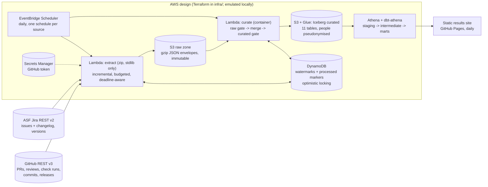
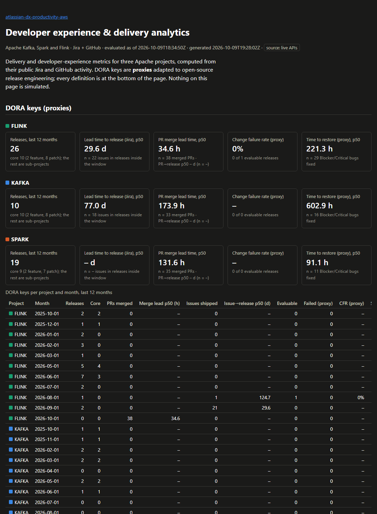

# Developer experience and DORA analytics on AWS (Apache Jira + GitHub)

[](https://github.com/rohit91jacob/atlassian-dx-productivity-aws/actions/workflows/ci.yml)
[](https://github.com/rohit91jacob/atlassian-dx-productivity-aws/actions/workflows/refresh.yml)
[](https://rohit91jacob.github.io/atlassian-dx-productivity-aws/)
[](LICENSE)
[-green.svg)](DATA_LICENSE.md)


Engineering-productivity analytics of the kind an Atlassian-style developer-experience team
runs, built on real public data: the Apache Software Foundation's **Jira** (KAFKA, SPARK, FLINK)
and the matching **GitHub** repositories (apache/kafka, apache/spark, apache/flink).

* **What it measures.** DORA's four keys (as documented proxies), the pull-request cycle-time
  breakdown (time to first review, review rounds, time to merge), Jira issue flow (lead and cycle
  time, throughput, reconstructed WIP, aging), reviewer load, CI health, and how well PRs link
  back to Jira keys.
* **How it is built.** An AWS serverless design: EventBridge Scheduler -> Lambda extractors
  (incremental, watermarks in DynamoDB with conditional writes) -> S3 raw zone -> curate Lambda
  -> Apache Iceberg (Glue catalog) -> dbt on Athena. Everything is in Terraform.
* **What is real and what is emulated.** The data is real and downloaded live. The cloud is
  **emulated**: no AWS account is used. The same Lambda code runs locally against a filesystem
  and SQLite stand-in, against **moto** in the tests (including Glue + Iceberg on S3), and against
  **LocalStack** in CI. Terraform is validated (fmt, validate, tflint, checkov), never applied.
  dbt runs on DuckDB and is compiled for Athena through the real dbt-athena adapter.
* **Proof.** Weekly Jira throughput matches Jira's own server-side counts for 6 of 6
  project-weeks, and daily merged-PR counts match GitHub search for both repositories that use
  GitHub's merge button. Release dates agree with the official download pages for 30 of 45
  releases; the 14 differences (12 of them Flink) are real disagreements between Jira and the
  announcements, reported in [docs/verification.md](docs/verification.md).

## Architecture



Locally and in the scheduled GitHub Actions refresh, the same code runs with `DX_BACKEND=local`
(filesystem for S3, SQLite for DynamoDB), a pyiceberg SQLite catalog for Glue, and DuckDB for
Athena.

| Component | Code | What it does |
|---|---|---|
| HTTP client | `http.py` | Standard library only. Retries with jittered backoff on 429/5xx, truncated bodies and network errors; honours `Retry-After`; stops cleanly on GitHub's primary rate limit; per-run request budget; request pacing. |
| Jira extractor | `extract/jira.py` | JQL `updated >= watermark - overlap ORDER BY updated, key` with the changelog. Keyset pagination on the `updated` minute, so an issue edited mid-run is never skipped (tested). Checkpoints the watermark after every landed page. Versions snapshot per run. |
| GitHub extractor | `extract/github.py` | PRs listed newest-updated first down to the watermark; reviews and head-commit check runs fetched oldest-first; the watermark passes a PR only once its details are landed, so a budget stop resumes without gaps (tested). Default-branch commits by `since`. |
| Raw zone | `extract/raw.py`, `storage/objects.py` | Each response stored as received in a deterministic gzip envelope with its request; S3 or filesystem. |
| State | `storage/state.py`, `extract/watermark.py` | DynamoDB or SQLite with conditional writes on a `version` attribute: a racing run gets `ConflictError`, never a lost update. |
| Curate | `curate/` | Raw gate, then pure normalisers (pseudonymise people, parse Jira keys from PR titles, detect `Closes #123` merges), then a latest-version-wins merge at the parent grain (a newer issue replaces its whole set of transitions and versions), curated gate, Iceberg copy-on-write publish with a content hash. Unchanged tables are not rewritten. |
| Data quality | `quality/checks.py`, dbt tests | 3 gates: raw envelope shape; 40 curated checks (keys, orphans, timestamps, states); 110 dbt tests and 7 mart checks. `error` blocks the layer (exit 3), `warn` is recorded. Results land in `ops/dq_results/`. |
| dbt | `dbt/` | 11 staging views, 7 intermediate and 11 mart tables. Cross-engine macros (`percentile`, `hours_between`, `count_when`) so the same SQL runs on DuckDB and Athena. |
| Lambdas | `lambdas/handlers.py` | `extract_handler` (zip, no third-party wheels, enforced by a test) and `curate_handler` (container). |
| Report | `report/site.py` | Static HTML + inline SVG, no JavaScript, table view for every chart. |
| Verification | `verify/published.py` | Live comparison with release pages, release notes, Jira and GitHub search counts. |
| Infrastructure | `infra/` | Terraform modules: KMS, data lake (4 buckets), state table, Lambda (x2), scheduler, analytics (Glue, Athena), monitoring (alarms, budget), GitHub OIDC deploy role. |

## Tech stack

All Python versions are pinned in `uv.lock`.

| Layer | Technology | Version |
|---|---|---|
| Language, packaging | Python, uv, hatchling | 3.12, uv 0.10 |
| Extraction | Python standard library (`urllib`), boto3 | boto3 1.43.110 |
| Table format | Apache Iceberg via pyiceberg (SQL catalog locally, Glue on AWS), pyarrow | pyiceberg 0.12.0, pyarrow 26.0.0 |
| Transform | dbt-core, dbt-duckdb (local/CI), dbt-athena (AWS) | 1.12.5, 1.11.0, 1.11.1 |
| Local warehouse | DuckDB | 1.5.6 |
| AWS emulation | moto (in-process and server), LocalStack (CI) | moto 5.2.3, LocalStack 4.4.0 |
| Infrastructure as code | Terraform, AWS provider, tflint, checkov | 1.16.5, ~> 6.68, 0.64.0, 3.3.26 |
| Quality tooling | pytest, ruff, pre-commit, gitleaks, Dependabot | pytest 9.1, ruff 0.16.10, gitleaks 8.30.1 |

## Data sources

| | ASF Jira | GitHub |
|---|---|---|
| Endpoint | `https://issues.apache.org/jira/rest/api/2/search`, `/project/{key}/versions` (anonymous) | `https://api.github.com/repos/apache/{kafka,spark,flink}/...` |
| Scope | KAFKA, SPARK, FLINK: every issue updated since the first watermark, with status history; all versions | PRs, reviews, check runs (closed PRs), default-branch commits, releases |
| Licence | Apache License 2.0 (ASF contributions); see [DATA_LICENSE.md](DATA_LICENSE.md) | GitHub Terms of Service; PR titles and commits are ASF contributions (Apache-2.0) |
| Refresh cadence | Changes continuously; refreshed **daily** | Changes continuously; refreshed **daily** |
| Rate limits | Shared volunteer infrastructure: paced at 1 request/second | 60/h unauthenticated, 5,000/h with a token, 1,000/h per repo with the Actions token |
| Known gaps | Changelog histories beyond what the search API returns are flagged (`is_changelog_truncated`); issues not updated since the first watermark are not extracted | Airflow is excluded (it does not use the ASF Jira). Kafka, Spark and Flink publish no GitHub Releases, so releases come from Jira versions. Flink CI does not report GitHub check runs. Only the first 100 check runs per commit are read. |

## Data model

| Layer | Tables (grain) |
|---|---|
| Raw (S3) | `raw/{jira,github}/<entity>/scope=<project or repo>/dt=<date>/<run>.json.gz`: API pages as received |
| State (DynamoDB) | watermarks per source x scope x entity, processed-object markers |
| Curated (Iceberg) | `jira_issues` (issue), `jira_status_transitions` (status change), `jira_issue_versions` (issue x fix/affects version), `jira_versions` (release), `gh_pull_requests` (PR), `gh_reviews` (review), `gh_check_runs` (check run), `gh_pr_fetches` (PR x detail kind), `gh_commits` (commit), `gh_releases`, `gh_pr_jira_links` (PR x Jira key) |
| Marts (dbt) | `fct_pull_requests`, `fct_jira_issues`, `fct_releases`, `mart_dora_monthly`, `mart_pr_cycle_time_weekly`, `mart_issue_flow_weekly`, `mart_issue_aging`, `mart_reviewer_load_weekly`, `mart_reviewer_load_summary`, `mart_pr_jira_linkage`, `mart_ci_health_weekly` |

Columns, keys and every metric definition are in the
**[data dictionary](docs/data_dictionary.md)**.

### Metrics and the proxies behind them

| Metric | Computed as | Proxy because |
|---|---|---|
| Deployment frequency | Released Jira versions per month (core vs sub-project versions split) | OSS ships releases to mirrors, not deployments |
| Lead time for changes | Jira: issue reported -> its first released fix version. PR: PR opened -> the release that shipped its Jira key | Starts at "reported"/"opened", not first commit; release dates are day-granular |
| Change failure rate | Releases with a Blocker/Critical Bug affecting them, reported within 30 days / evaluable releases | Bug reports are a lagging, partial signal |
| Time to restore | Median report -> fix of Blocker/Critical Bugs | Repository fix time, not service restoration |
| PR cycle time | Created -> first human review -> first approval -> merge; review rounds = reviewed revisions | GitHub review objects only (comment-only review is not seen) |
| Merged | GitHub `merged_at`, or a default-branch commit naming the PR (`Closes #123`, `(#123)`) | Spark merges through a script, never through GitHub |

## Results from a real run

From a real download on **9 October 2026** (Jira: 60-day window; GitHub: a 3-day window,
unauthenticated, so PR details were **sampled**: reviews for 52 of the 569 PRs updated in the
window). These are the numbers on the generated site; the daily refresh in Actions uses 90 days
of Jira, 30 days of GitHub and an authenticated GitHub budget. PR merge metrics count only PRs
merged inside the GitHub window (from 6 October 2026, about 12:20-14:45 UTC depending on the
repository): a PR merged earlier is in the data only if something touched it later, which is a
biased sample (`int_github_coverage`).

| | Kafka | Spark | Flink |
|---|---|---|---|
| Jira issues in window | 831 | 2,035 | 1,363 |
| Releases, last 12 months (core) | 10 (10) | 19 (9) | 26 (10) |
| Lead time to release, Jira, p50 | 77.0 d (n = 18) | n/a: no core release in the window | 29.6 d (n = 22) |
| Time to restore proxy, p50 | 602.9 h (n = 16) | 91.1 h (n = 11) | 221.3 h (n = 29) |
| Weekly throughput, mean of complete weeks | 25.1 | 137.1 | 55.7 |
| WIP at week end, mean | 132.0 | 12.9 | 38.4 |
| PRs merged in the 3-day window / via commit reference | 33 / 0 | 35 / 35 | 38 / 4 |
| PR time to merge, p50 | 173.9 h | 131.6 h | 34.6 h |
| Merged PRs naming a Jira key | 23 of 33 | 33 of 35 | 37 of 38 |
| Closed PRs with a failed check run (sample) | 9% of 11 | 23% of 13 | no GitHub check runs |



Change failure rate is shown as "not evaluable" for now: with a 60-day window only one release
(Flink) had both its release and its 30-day bug window inside the data; it had no escaped
Blocker/Critical bug. It fills in as the daily refresh accumulates history.

## Quickstart

### Prerequisites

* Python 3.12 and [uv](https://docs.astral.sh/uv/); internet access to issues.apache.org and
  api.github.com
* Optional: `GITHUB_TOKEN` (read-only, public repositories) for more than 60 GitHub requests
  per hour
* For the infrastructure checks: Terraform >= 1.9, tflint, and `uvx` for checkov

### Offline, on the recorded fixtures (what CI runs)

```bash
git clone https://github.com/rohit91jacob/atlassian-dx-productivity-aws.git
cd atlassian-dx-productivity-aws
uv sync --frozen
DX_SOURCE=fixtures DX_DATA_DIR=.fixture-run uv run dx run   # extract -> curate -> dbt -> DQ, about 1 minute
DX_SOURCE=fixtures DX_DATA_DIR=.fixture-run uv run dx report --out site
```

### Live

```bash
cp .env.example .env            # 60 days of Jira, 3 days of GitHub, 50-request GitHub budget
uv run dx run                   # first run: about 3 minutes for Jira, then curate + dbt
uv run dx run                   # later runs are incremental (one Jira page per project: ~10 s)
uv run dx report --out site     # open site/index.html
uv run dx verify --out verification-run.md
uv run dx sql "SELECT * FROM marts.mart_dora_monthly WHERE month >= DATE '2026-01-01' ORDER BY 1, 2"
```

Measured on the author's laptop (Windows 11): the first Jira extraction of 60 days landed
4,220 issues in 91 raw objects in 185 s; the next incremental run fetched 69 changed issues in
10 s. Curate + dbt build (141 nodes) + mart DQ on that data took about 75 s on a re-run during review.

`make help` lists the targets (`make test`, `make pipeline`, `make infra-check`, ...); each
target is a one-line wrapper, so the commands also work without `make`.

## Cloud mapping

| Here (local / CI) | AWS service (infra/) | Notes |
|---|---|---|
| `dx extract` / `extract_handler` called by cron or Actions | EventBridge Scheduler -> Lambda (python3.12, arm64, zip) | One schedule per source; reserved concurrency 1; DLQ; X-Ray |
| Filesystem stand-in (`LocalObjectStore`) | S3 raw bucket, SSE-KMS, versioned, lifecycle to STANDARD_IA | moto and LocalStack run the real `S3ObjectStore` |
| SQLite stand-in (`SqliteStateStore`) | DynamoDB on-demand, PITR, KMS, deletion protection | Same conditional-write contract, tested on both |
| `GITHUB_TOKEN` env var | Secrets Manager secret, KMS | Read once per Lambda container |
| pyiceberg SQL catalog + local warehouse | Glue Data Catalog + S3 curated bucket | Glue + Iceberg on S3 tested on a moto server |
| `curate_handler` in-process | Lambda container image from ECR (immutable tags, scan on push) | `infra/lambda/curate.Dockerfile`, built in CI |
| DuckDB + dbt-duckdb | Athena (engine v3) workgroup + dbt-athena | Athena SQL compiled in CI; per-query scan cutoff |
| `ops/dq_results/` + exit codes + GitHub issue alert | CloudWatch alarms (errors, no runs in 26 h) -> SNS (KMS) | |
| none | AWS Budgets monthly budget, 80% actual / 100% forecast alerts | |
| GitHub Pages site | (unchanged) | |
| `deploy.yml` (skipped unless `AWS_DEPLOY_ROLE_ARN` is set) | IAM role trusted by GitHub OIDC for this repo's `main` / `aws` environment | No static AWS keys anywhere |

## Cost notes

Nothing here has been deployed, so these are estimates from public pricing, not a bill. At this
scale (one run per day, a few thousand issues, under 10 MB of gzip raw data per day) Lambda,
DynamoDB on-demand, S3, Scheduler and Glue stay within or near the free tier. Fixed costs are a
customer-managed KMS key (about 1 USD/month), Secrets Manager (about 0.40 USD/month) and
CloudWatch alarms (about 0.10 USD each). Athena charges per byte scanned; the marts are tiny,
and the workgroup refuses queries over 1 GB. The Lambdas deliberately run outside a VPC: a NAT
gateway alone (about 32 USD/month) would exceed the 10 USD default budget.

## Testing and CI

```bash
uv run pytest tests/unit      # 79 tests, no network
uv run pytest tests/aws       # 6 tests: Lambda handlers on moto, Glue + Iceberg on a moto S3 server
uv run pytest tests/e2e       # 4 end-to-end tests on the recorded fixtures (about 2 minutes)
```

The fixtures are 154 real Jira issues, every version of the three projects, and 111 real pull
requests with their reviews, check runs and commits, recorded on 9 October 2026, trimmed and
pseudonymised (`scripts/build_fixtures.py`). Offline API emulators serve them with the real
query semantics, so the unmodified extractors run against them. The tests check that:

* a rerun changes nothing downstream and writes **no new Iceberg snapshots**; a full refresh
  reproduces the incremental result exactly; new activity is picked up incrementally;
* keyset pagination survives issues changing mid-run; a GitHub budget stop resumes without gaps;
* conditional writes reject a racing run on both SQLite and DynamoDB;
* a corrupt raw object stops curation (exit 3) with nothing published; a broken relationship
  fails dbt tests (exit 3);
* the extractor Lambda imports no third-party wheels.

| Workflow | Trigger | What it does |
|---|---|---|
| [`ci.yml`](.github/workflows/ci.yml) | every push and PR | lint (ruff, `uv lock --check`, gitleaks, fixture size), unit + moto tests, pipeline on fixtures (twice) + e2e + site + dbt docs, dbt compile for Athena, terraform (fmt, validate, tflint, checkov), Lambda zip + arm64 curate image build, LocalStack integration |
| [`refresh.yml`](.github/workflows/refresh.yml) | daily 05:30 UTC, or manually | Restores the lake from the Actions cache, extracts incrementally with the run's `GITHUB_TOKEN`, runs curate -> dbt -> DQ, verifies against published figures, publishes the site to Pages; opens an issue on failure |
| [`keepalive.yml`](.github/workflows/keepalive.yml) | 1st and 15th of the month | Re-enables the scheduled workflows so GitHub's 60-day inactivity rule never disables them |
| [`deploy.yml`](.github/workflows/deploy.yml) | manual, only if `AWS_DEPLOY_ROLE_ARN` is set | OIDC into AWS, ship the Lambda zip and curate image, dbt build on Athena |

**Not run locally:** the LocalStack job, the Docker image build and the gitleaks container
(the author's machine has no Docker), and the deploy workflow (no AWS account). The LocalStack
test was run locally against a moto server instead, through the same endpoint code path. All
actions are pinned by commit SHA.

## Operations

See the [runbook](docs/runbook.md) for backfills, full refreshes, data-quality failures, rate
limits, failed scheduled refreshes, credential rotation and deploying to AWS.

## Project structure

```
src/dx_productivity/
  cli.py                 # `dx` entrypoint (extract, curate, transform, dq, run, report, verify, state, sql)
  config.py  http.py  logs.py  pseudonym.py
  extract/               # jira.py, github.py, raw.py, watermark.py, runner.py, emulators.py
  storage/               # objects.py (S3 / filesystem), state.py (DynamoDB / SQLite)
  curate/                # schemas.py, normalize.py, pipeline.py, iceberg.py
  quality/checks.py      # raw, curated and mart gates
  transform/dbt.py       # curated snapshot -> DuckDB, dbtRunner
  lambdas/handlers.py    # extract_handler, curate_handler
  report/site.py         # static results site
  verify/published.py    # reconciliation with published figures
dbt/                     # staging, intermediate, marts, seeds, macros, tests; DuckDB + Athena profiles
infra/                   # Terraform root + modules, tflint config, curate Lambda Dockerfile
tests/                   # unit/, aws/ (moto, LocalStack), e2e/, fixtures/api (real, trimmed)
scripts/                 # build_fixtures.py, package_lambda.py, dbt_athena_compile.py
docs/                    # data_dictionary.md, runbook.md, verification.md
verification/            # published_figures.json (sources for dx verify)
```

## Design decisions and trade-offs

* **Standard-library extractor.** The extract Lambda is a 45 KB zip with no layers; requests,
  retries and rate limits are handled in `http.py`, which the unit tests drive through scripted transports.
* **Keyset pagination for Jira.** Offset paging over a list ordered by `updated` skips an issue
  whenever another one is edited mid-run. Restarting from the last minute seen costs a few
  duplicate rows, which the merge removes.
* **Watermark after landing.** Every watermark moves only after the data it covers is durably in
  the raw zone, so a crash or timeout can repeat work but never lose it.
* **Parent-level merges.** Child records (status history, fix versions, reviews) are replaced as
  a set when their parent changes, and an explicit parent marker handles "now has none".
* **Copy-on-write Iceberg overwrite per run.** The curated tables are small (under 10,000 rows
  each here), so a full per-table overwrite guarded by a content hash keeps merge logic in one
  tested function. Past millions of rows this would become a partition-scoped overwrite or an
  Athena `MERGE INTO`.
* **dbt reads a DuckDB snapshot of the curated tables** (`curated._snapshots` records the Iceberg
  snapshot ids), the local stand-in for Athena reading Glue tables. On AWS, dbt reads the
  Iceberg tables directly.
* **Pseudonymised people.** Reviewer load is reported as distributions, never leaderboards.

## Limitations

* **Sampled GitHub details in the local run.** Without a token, 60 requests/hour (shared with
  everything else on the IP) allowed reviews for 52 PRs. Review-based numbers above are
  indicative only; the Actions refresh uses an authenticated budget.
* **Window effects.** Only issues and PRs updated since the first watermark are extracted, so WIP
  and aging miss long-untouched issues, CFR/lead-time-to-release only cover releases inside the
  window (`int_jira_coverage`), and PR merge metrics only cover merges inside the GitHub window
  (`int_github_coverage`). CI health is still reported by week of close for every closed PR whose
  check runs were fetched.
* **Spark merge inference** depends on the merge script's `Closes #N from ...` line and on the
  commit being inside the extracted commit window.
* **Release dates are Jira's.** For Flink they differ from the announcement dates by up to two
  weeks ([verification](docs/verification.md)).
* **Not deployed.** The AWS design is validated statically and through emulators only. LocalStack
  free tier has no Glue, so the CI LocalStack job uses the SQL catalog with Iceberg on LocalStack
  S3; Glue is exercised on moto.
* **Windows note.** pyiceberg's default file IO cannot parse Windows `file://` paths, so local
  warehouses use the fsspec file IO on every OS.

## Licence

Code: [MIT](LICENSE). Data: Apache Software Foundation contributions under the Apache License
2.0, read through the ASF Jira and GitHub APIs; see [DATA_LICENSE.md](DATA_LICENSE.md) for
what is committed, how it is pseudonymised, and the attribution to use.
