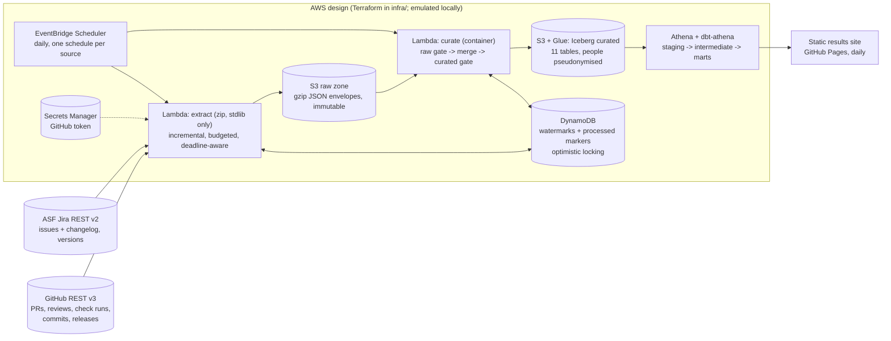

# Developer experience and DORA analytics on AWS (Apache Jira + GitHub)

[](https://github.com/rohit91jacob/atlassian-dx-productivity-aws/actions/workflows/ci.yml)
[](https://github.com/rohit91jacob/atlassian-dx-productivity-aws/actions/workflows/refresh.yml)
[](https://rohit91jacob.github.io/atlassian-dx-productivity-aws/)
[](LICENSE)
[-green.svg)](DATA_LICENSE.md)


Engineering-productivity analytics of the kind an Atlassian-style developer-experience team
runs, built on real public data: the Apache Software Foundation's **Jira** (KAFKA, SPARK, FLINK)
and the matching **GitHub** repositories (apache/kafka, apache/spark, apache/flink).

* **What it measures.** DORA's four keys (as documented proxies), the pull-request cycle-time
  breakdown (time to first review, review rounds, time to merge), Jira issue flow (lead and cycle
  time, throughput, reconstructed WIP, aging), reviewer load, CI health, and how well PRs link
  back to Jira keys.
* **How it is built.** An AWS serverless design: EventBridge Scheduler -> Lambda extractors
  (incremental, watermarks in DynamoDB with conditional writes) -> S3 raw zone -> curate Lambda
  -> Apache Iceberg (Glue catalog) -> dbt on Athena. Everything is in Terraform.
* **What is real and what is emulated.** The data is real and downloaded live. The cloud is
  **emulated**: no AWS account is used. The same Lambda code runs locally against a filesystem
  and SQLite stand-in, against **moto** in the tests (including Glue + Iceberg on S3), and against
  **LocalStack** in CI. Terraform is validated (fmt, validate, tflint, checkov), never applied.
  dbt runs on DuckDB and is compiled for Athena through the real dbt-athena adapter.
* **Proof.** Checked against figures fetched live ([docs/verification.md](docs/verification.md)):
  release dates match the Jira versions API for 44 of 44 releases, Kafka release contents match
  the official release notes for all 47 comparable issues, weekly Jira throughput matches Jira's
  own server-side count for 12 of 12 project-weeks, and daily merged-PR counts match GitHub
  search for 14 of 14 repository-days. Jira's release dates differ from the projects'
  announcement pages for 14 of 45 releases (12 of them Flink), and one announced release is
  not marked released in Jira: differences between the two sources, documented release by
  release.

## Architecture



Locally and in the scheduled GitHub Actions refresh, the same code runs with `DX_BACKEND=local`
(filesystem for S3, SQLite for DynamoDB), a pyiceberg SQLite catalog for Glue, and DuckDB for
Athena.

| Component | Code | What it does |
|---|---|---|
| HTTP client | `http.py` | Standard library only. Retries with jittered backoff on 429/5xx, truncated bodies and network errors; honours `Retry-After`; stops cleanly on GitHub's primary rate limit; per-run request budget; request pacing. |
| Jira extractor | `extract/jira.py` | JQL `updated >= watermark - overlap ORDER BY updated, key` with the changelog. Keyset pagination on the `updated` minute, so an issue edited mid-run is never skipped (tested). Checkpoints the watermark after every landed page. Versions snapshot per run. |
| GitHub extractor | `extract/github.py` | PRs listed newest-updated first down to the watermark; reviews and head-commit check runs fetched oldest-first; the watermark passes a PR only once its details are landed, so a budget stop resumes without gaps (tested). Default-branch commits by `since`. |
| Raw zone | `extract/raw.py`, `storage/objects.py` | Each response stored as received in a deterministic gzip envelope with its request; S3 or filesystem. |
| State | `storage/state.py`, `extract/watermark.py` | DynamoDB or SQLite with conditional writes on a `version` attribute: a racing run gets `ConflictError`, never a lost update. |
| Curate | `curate/` | Raw gate, then pure normalisers (pseudonymise people, parse Jira keys from PR titles, detect `Closes #123` merges), then a latest-version-wins merge at the parent grain (a newer issue replaces its whole set of transitions and versions), curated gate, Iceberg copy-on-write publish with a content hash. Unchanged tables are not rewritten. |
| Data quality | `quality/checks.py`, dbt tests | 3 gates: raw envelope shape; 40 curated checks (keys, orphans, timestamps, states); 121 dbt tests and 7 mart checks. `error` blocks the layer (exit 3), `warn` is recorded. Results land in `ops/dq_results/`. |
| dbt | `dbt/` | 11 staging views, 7 intermediate and 11 mart tables. Cross-engine macros (`percentile`, `hours_between`, `count_when`) so the same SQL runs on DuckDB and Athena. |
| Lambdas | `lambdas/handlers.py` | `extract_handler` (zip, no third-party wheels, enforced by a test) and `curate_handler` (container). |
| Report | `report/site.py` | Static HTML + inline SVG, no JavaScript, table view for every chart. Weekly PR figures show their sample size n (a strip under the chart, an n column for each figure in the table); figures from fewer than 5 PRs are marked as small samples, and the chart leaves those weeks out. |
| Verification | `verify/published.py` | Live comparison of pipeline outputs with the Jira versions API, release pages, release notes, Jira's own counts and GitHub search, each scoped like-for-like. |
| Infrastructure | `infra/` | Terraform modules: KMS, data lake (4 buckets), state table, Lambda (x2), scheduler, analytics (Glue, Athena), monitoring (alarms, budget), GitHub OIDC deploy role. |

## Tech stack

All Python versions are pinned in `uv.lock`.

| Layer | Technology | Version |
|---|---|---|
| Language, packaging | Python, uv, hatchling | 3.12, uv 0.10 |
| Extraction | Python standard library (`urllib`), boto3 | boto3 1.43.110 |
| Table format | Apache Iceberg via pyiceberg (SQL catalog locally, Glue on AWS), pyarrow | pyiceberg 0.12.0, pyarrow 26.0.0 |
| Transform | dbt-core, dbt-duckdb (local/CI), dbt-athena (AWS) | 1.12.5, 1.11.0, 1.11.1 |
| Local warehouse | DuckDB | 1.5.6 |
| AWS emulation | moto (in-process and server), LocalStack (CI) | moto 5.2.3, LocalStack 4.4.0 |
| Infrastructure as code | Terraform, AWS provider, tflint, checkov | 1.16.5, ~> 6.68, 0.64.0, 3.3.26 |
| Quality tooling | pytest, ruff, pre-commit, gitleaks, Dependabot | pytest 9.1, ruff 0.16.10, gitleaks 8.30.1 |

## Data sources

| | ASF Jira | GitHub |
|---|---|---|
| Endpoint | `https://issues.apache.org/jira/rest/api/2/search`, `/project/{key}/versions` (anonymous) | `https://api.github.com/repos/apache/{kafka,spark,flink}/...` |
| Scope | KAFKA, SPARK, FLINK: every issue updated since the first watermark, with status history; all versions | PRs, reviews, check runs (closed PRs), default-branch commits, releases |
| Licence | Apache License 2.0 (ASF contributions); see [DATA_LICENSE.md](DATA_LICENSE.md) | GitHub Terms of Service; PR titles and commits are ASF contributions (Apache-2.0) |
| Refresh cadence | Changes continuously; refreshed **daily** | Changes continuously; refreshed **daily** |
| Rate limits | Shared volunteer infrastructure: paced at 1 request/second | 60/h unauthenticated, 5,000/h with a token, 1,000/h per repo with the Actions token |
| Known gaps | Changelog histories beyond what the search API returns are flagged (`is_changelog_truncated`); issues not updated since the first watermark are not extracted | Airflow is excluded (it does not use the ASF Jira). Kafka, Spark and Flink publish no GitHub Releases, so releases come from Jira versions. Flink CI does not report GitHub check runs. Only the first 100 check runs per commit are read. |

## Data model

| Layer | Tables (grain) |
|---|---|
| Raw (S3) | `raw/{jira,github}/<entity>/scope=<project or repo>/dt=<date>/<run>.json.gz`: API pages as received |
| State (DynamoDB) | watermarks per source x scope x entity, processed-object markers |
| Curated (Iceberg) | `jira_issues` (issue), `jira_status_transitions` (status change), `jira_issue_versions` (issue x fix/affects version), `jira_versions` (release), `gh_pull_requests` (PR), `gh_reviews` (review), `gh_check_runs` (check run), `gh_pr_fetches` (PR x detail kind), `gh_commits` (commit), `gh_releases`, `gh_pr_jira_links` (PR x Jira key) |
| Marts (dbt) | `fct_pull_requests`, `fct_jira_issues`, `fct_releases`, `mart_dora_monthly`, `mart_pr_cycle_time_weekly`, `mart_issue_flow_weekly`, `mart_issue_aging`, `mart_reviewer_load_weekly`, `mart_reviewer_load_summary`, `mart_pr_jira_linkage`, `mart_ci_health_weekly` |

Columns, keys and every metric definition are in the
**[data dictionary](docs/data_dictionary.md)**.

### Metrics and the proxies behind them

| Metric | Computed as | Proxy because |
|---|---|---|
| Deployment frequency | Released Jira versions per month (core vs sub-project versions split) | OSS ships releases to mirrors, not deployments |
| Lead time for changes | Jira: issue reported -> its first released fix version. PR: PR opened -> the release that shipped its Jira key | Starts at "reported"/"opened", not first commit; release dates are day-granular |
| Change failure rate | Releases with a Blocker/Critical Bug affecting them, reported within 30 days / evaluable releases | Bug reports are a lagging, partial signal |
| Time to restore | Median report -> fix of Blocker/Critical Bugs | Repository fix time, not service restoration |
| PR cycle time | Created -> first human review -> first approval -> merge; review rounds = reviewed revisions | GitHub review objects only (comment-only review is not seen) |
| Merged | GitHub `merged_at`, or a default-branch commit naming the PR (`Closes #123`, `(#123)`) | Spark merges through a script, never through GitHub |

## Results from a real run

From a real download on **10 October 2026** (Jira: 90-day window from 12 July 2026; GitHub:
30-day window from 10 September 2026, authenticated, with reviews fetched for all 2,260 PRs
updated in the window and check runs for every closed one). These are the numbers on the
generated site, from the warehouse that [docs/verification.md](docs/verification.md) checks. PR
merge metrics count only PRs merged inside the GitHub window: a PR merged earlier is in the data
only if something touched it later, which is a biased sample (`int_github_coverage`).

| | Kafka | Spark | Flink |
|---|---|---|---|
| Jira issues in window | 1,046 | 2,823 | 1,635 |
| Releases, last 12 months (core) | 10 (10) | 19 (9) | 27 (10) |
| Lead time to release, Jira, p50 | 82.6 d (n = 21) | 40.4 d (n = 141) | 75.9 d (n = 114) |
| Time to restore proxy, p50 | 419.6 h (n = 24) | 90.4 h (n = 13) | 338.6 h (n = 31) |
| Change failure rate proxy | not evaluable yet (0 releases) | 60% (3 of 5 releases) | 0% (0 of 3 releases) |
| Weekly throughput, mean of 12 complete weeks | 26.8 | 134.2 | 46.4 |
| WIP at week end, mean | 159.2 | 14.8 | 38.8 |
| PRs merged in the 30-day window / via commit reference | 227 / 0 | 384 / 384 | 233 / 15 |
| PR time to merge, p50 | 60.8 h | 77.3 h | 38.5 h |
| PR time to first review, p50 | 13.1 h | 11.8 h | 9.5 h |
| Merged PRs naming a Jira key | 131 of 227 | 371 of 384 | 211 of 233 |
| Closed PRs with a failed check run | 5% of 299 | 13% of 639 | 5% of 20 (most Flink CI is outside GitHub) |


The change failure rate proxy needs a release whose 30-day bug window has passed and lies inside
the extracted Jira history; with 90 days of Jira that is 8 releases (Spark 5, Flink 3, Kafka
none yet). It covers more releases as the daily refresh accumulates history.

## Quickstart

### Prerequisites

* Python 3.12 and [uv](https://docs.astral.sh/uv/); internet access to issues.apache.org and
  api.github.com
* Optional: `GITHUB_TOKEN` (read-only, public repositories) for more than 60 GitHub requests
  per hour
* For the infrastructure checks: Terraform >= 1.9, tflint, and `uvx` for checkov

### Offline, on the recorded fixtures (what CI runs)

```bash
git clone https://github.com/rohit91jacob/atlassian-dx-productivity-aws.git
cd atlassian-dx-productivity-aws
uv sync --frozen
DX_SOURCE=fixtures DX_DATA_DIR=.fixture-run uv run dx run   # extract -> curate -> dbt -> DQ, about 1 minute
DX_SOURCE=fixtures DX_DATA_DIR=.fixture-run uv run dx report --out site
```

### Live

```bash
cp .env.example .env            # 60 days of Jira, 3 days of GitHub, 50-request GitHub budget, no token
uv run dx run                   # first run: about 3 minutes for Jira, then curate + dbt
uv run dx run                   # later runs are incremental (one Jira page per project)
uv run dx report --out site     # open site/index.html
uv run dx verify --out verification-run.md
uv run dx sql "SELECT * FROM marts.mart_dora_monthly WHERE month >= DATE '2026-01-01' ORDER BY 1, 2"
```

The run in the results above was authenticated (`GITHUB_TOKEN` set) and used
`DX_JIRA_LOOKBACK_DAYS=90`, `DX_GITHUB_LOOKBACK_DAYS=30` and `DX_GITHUB_MAX_REQUESTS=4500`
(commands in [docs/verification.md](docs/verification.md#reproduce)). Measured on the author's
laptop (Windows 11): its first Jira extraction landed 5,488 issues in 119 raw objects in
226 s; the first GitHub extraction made 3,530 requests in 63 minutes and fetched the details
of every PR; later incremental `dx run`s (extract, curate, dbt build, mart DQ) took 2 to 5
minutes.

`make help` lists the targets (`make test`, `make pipeline`, `make infra-check`, ...); each
target is a one-line wrapper, so the commands also work without `make`.

## Cloud mapping

| Here (local / CI) | AWS service (infra/) | Notes |
|---|---|---|
| `dx extract` / `extract_handler` called by cron or Actions | EventBridge Scheduler -> Lambda (python3.12, arm64, zip) | One schedule per source; reserved concurrency 1; DLQ; X-Ray |
| Filesystem stand-in (`LocalObjectStore`) | S3 raw bucket, SSE-KMS, versioned, lifecycle to STANDARD_IA | moto and LocalStack run the real `S3ObjectStore` |
| SQLite stand-in (`SqliteStateStore`) | DynamoDB on-demand, PITR, KMS, deletion protection | Same conditional-write contract, tested on both |
| `GITHUB_TOKEN` env var | Secrets Manager secret, KMS | Read once per Lambda container |
| pyiceberg SQL catalog + local warehouse | Glue Data Catalog + S3 curated bucket | Glue + Iceberg on S3 tested on a moto server |
| `curate_handler` in-process | Lambda container image from ECR (immutable tags, scan on push) | `infra/lambda/curate.Dockerfile`, built in CI |
| DuckDB + dbt-duckdb | Athena (engine v3) workgroup + dbt-athena | Athena SQL compiled in CI; per-query scan cutoff |
| `ops/dq_results/` + exit codes + GitHub issue alert | CloudWatch alarms (errors, no runs in 26 h) -> SNS (KMS) | |
| none | AWS Budgets monthly budget, 80% actual / 100% forecast alerts | |
| GitHub Pages site | (unchanged) | |
| `deploy.yml` (skipped unless `AWS_DEPLOY_ROLE_ARN` is set) | IAM role trusted by GitHub OIDC for this repo's `main` / `aws` environment | No static AWS keys anywhere |

## Cost notes

Nothing here has been deployed, so these are estimates from public pricing, not a bill. At this
scale (one run per day, a few thousand issues, under 10 MB of gzip raw data per day) Lambda,
DynamoDB on-demand, S3, Scheduler and Glue stay within or near the free tier. Fixed costs are a
customer-managed KMS key (about 1 USD/month), Secrets Manager (about 0.40 USD/month) and
CloudWatch alarms (about 0.10 USD each). Athena charges per byte scanned; the marts are tiny,
and the workgroup refuses queries over 1 GB. The Lambdas deliberately run outside a VPC: a NAT
gateway alone (about 32 USD/month) would exceed the 10 USD default budget.

## Testing and CI

```bash
uv run pytest tests/unit      # 91 tests, no network
uv run pytest tests/aws       # 6 tests: Lambda handlers on moto, Glue + Iceberg on a moto S3 server
uv run pytest tests/e2e       # 4 end-to-end tests on the recorded fixtures (about 2 minutes)
```

The fixtures are 154 real Jira issues, every version of the three projects, and 111 real pull
requests with their reviews, check runs and commits, recorded on 9 October 2026, trimmed and
pseudonymised (`scripts/build_fixtures.py`). Offline API emulators serve them with the real
query semantics, so the unmodified extractors run against them. The tests check that:

* a rerun changes nothing downstream and writes **no new Iceberg snapshots**; a full refresh
  reproduces the incremental result exactly; new activity is picked up incrementally;
* keyset pagination survives issues changing mid-run; a GitHub budget stop resumes without gaps;
* conditional writes reject a racing run on both SQLite and DynamoDB;
* a corrupt raw object stops curation (exit 3) with nothing published; a broken relationship
  fails dbt tests (exit 3);
* the pipeline reproduces the figures `dx verify` compares against (Jira release dates, weekly
  Jira throughput, daily GitHub merges), counted directly from the recorded API responses;
* weekly PR figures carry their sample size, and small samples are flagged on the site and
  left out of its chart;
* the extractor Lambda imports no third-party wheels.

| Workflow | Trigger | What it does |
|---|---|---|
| [`ci.yml`](.github/workflows/ci.yml) | every push and PR | lint (ruff, `uv lock --check`, gitleaks, fixture size), unit + moto tests, pipeline on fixtures (twice) + e2e + site + dbt docs, dbt compile for Athena, terraform (fmt, validate, tflint, checkov), Lambda zip + arm64 curate image build, LocalStack integration |
| [`refresh.yml`](.github/workflows/refresh.yml) | daily 05:30 UTC, or manually | Restores the lake from the Actions cache, extracts incrementally with the run's `GITHUB_TOKEN`, runs curate -> dbt -> DQ, verifies against published figures, publishes the site to Pages; opens an issue on failure |
| [`keepalive.yml`](.github/workflows/keepalive.yml) | 1st and 15th of the month | Re-enables the scheduled workflows so GitHub's 60-day inactivity rule never disables them |
| [`deploy.yml`](.github/workflows/deploy.yml) | manual, only if `AWS_DEPLOY_ROLE_ARN` is set | OIDC into AWS, ship the Lambda zip and curate image, dbt build on Athena |

**Not run locally:** the LocalStack job, the Docker image build and the gitleaks container
(the author's machine has no Docker), and the deploy workflow (no AWS account). The LocalStack
test was run locally against a moto server instead, through the same endpoint code path. All
actions are pinned by commit SHA.

## Operations

See the [runbook](docs/runbook.md) for backfills, full refreshes, data-quality failures, rate
limits, failed scheduled refreshes, credential rotation and deploying to AWS.

## Project structure

```
src/dx_productivity/
  cli.py                 # `dx` entrypoint (extract, curate, transform, dq, run, report, verify, state, sql)
  config.py  http.py  logs.py  pseudonym.py
  extract/               # jira.py, github.py, raw.py, watermark.py, runner.py, emulators.py
  storage/               # objects.py (S3 / filesystem), state.py (DynamoDB / SQLite)
  curate/                # schemas.py, normalize.py, pipeline.py, iceberg.py
  quality/checks.py      # raw, curated and mart gates
  transform/dbt.py       # curated snapshot -> DuckDB, dbtRunner
  lambdas/handlers.py    # extract_handler, curate_handler
  report/site.py         # static results site
  verify/published.py    # reconciliation with published figures
dbt/                     # staging, intermediate, marts, seeds, macros, tests; DuckDB + Athena profiles
infra/                   # Terraform root + modules, tflint config, curate Lambda Dockerfile
tests/                   # unit/, aws/ (moto, LocalStack), e2e/, fixtures/api (real, trimmed)
scripts/                 # build_fixtures.py, package_lambda.py, dbt_athena_compile.py
docs/                    # data_dictionary.md, runbook.md, verification.md
verification/            # published_figures.json (sources for dx verify)
```

## Design rationale

Five constraints drove the design. The data is **live and public**: the ASF Jira is shared,
volunteer-run infrastructure, paced at 1 request/second, and GitHub's REST API allows 60
requests/hour without a token, 5,000 with one and 1,000 per repository for the Actions token, so
every run has to be incremental, budgeted, and safe to stop part-way and to rerun. The daily
refresh runs **without stored credentials**: Jira is read anonymously and GitHub with the
workflow's built-in `GITHUB_TOKEN`. **No AWS account is used**: `infra/` is validated, never
applied, and the same code runs against a filesystem and SQLite stand-in, moto and LocalStack, on
a Windows laptop without Docker and on free GitHub-hosted runners. Open-source projects ship
releases, not deployments, so **DORA's keys can only be proxies**, each defined in the open and
checked against an independent published figure. And the people in the data are real
contributors, so every identity is **pseudonymised** at curation (`pseudonym.py`) and reviewer
load is reported as distributions, never leaderboards.

### Architecture decisions

| Decision | Why | Alternatives considered | Trade-off accepted |
|---|---|---|---|
| **Incremental extraction, watermark after landing.** Watermarks sit in DynamoDB (SQLite locally) behind conditional writes on a `version` attribute (`storage/state.py`) and move only once the data they cover is in the raw zone. Jira pages keyset-style on the `updated` minute with a 60-minute overlap and checkpoints after every landed page (`extract/jira.py`); GitHub lists PRs newest-updated first down to the watermark, fetches their reviews and check runs oldest-first, and passes a PR only once its details are landed (`extract/github.py`) | A Lambda timeout, a budget stop or a crash can repeat work but never lose it, and a racing run gets `ConflictError` instead of a lost update (tested on SQLite and DynamoDB). Offset paging over a list ordered by `updated` skips an issue whenever another one is edited mid-run; restarting from the last minute seen cannot (tested). The extract handler stops 60 s before its timeout and the GitHub budget is split across repositories, so a backlog drains over several runs without gaps | `startAt` offset paging (skips issues edited mid-run); one watermark write at the end of a run (a timeout loses the whole run's progress); re-reading the whole window every day (the 30-day GitHub backfill took 3,530 requests; the Actions token allows 1,000 an hour per repository) | Boundary minutes and the overlap are read twice, landing duplicate rows that the merge removes; a run that loses the race fails instead of continuing; what was not updated since the first watermark is never extracted (see Limitations) |
| **Land raw, then merge into curated Iceberg.** Each response is stored as received, with its request, in an immutable, deterministic gzip envelope (`extract/raw.py`). Curate merges new objects at the parent grain: the newest `_version` wins, a winning issue or PR replaces its whole set of children (status history, fix versions, reviews), and an explicit parent marker covers "now has none" (`curate/pipeline.py`). Each changed table is overwritten copy-on-write in one Iceberg transaction with a content hash, and raw objects are marked processed last (`curate/iceberg.py`) | Curation replays from raw with no API calls: `--full-refresh` reproduces the incremental result exactly (tested) and carries a normaliser fix through all history. A whole-table overwrite keeps the merge logic in one tested function (`merge`); an unchanged table is not rewritten, so a rerun makes no new snapshots, and a crash between publish and marking re-merges the same objects, a no-op by construction | Writing curated rows straight from the extractor (an API change or a normaliser bug means downloading again); row-level upserts per record (a second write path to keep correct); append-only curated tables (every reader would have to deduplicate) | Every table is read, and each changed one rewritten whole, on every run, which suits the current size (5,504 issues and 2,260 PRs in the documented run), not millions of rows; raw is kept as the system of record (STANDARD_IA after 30 days); a normaliser change reaches old objects only through `--full-refresh` (runbook) |
| **A gate after each layer** (`quality/checks.py`): raw envelope shape before anything is normalised; 40 curated checks (keys, orphans, timestamps, states) on the merged tables before they are published; 121 dbt tests and 7 mart checks after dbt. `error` blocks the layer (exit 3), `warn` is recorded, and every result lands in `ops/dq_results/` | A bad API page or a normaliser bug stops at the layer it breaks: nothing is published, the curated tables keep their previous snapshot, and the raw objects stay unprocessed for the next run. A corrupt raw object and a failing dbt test are both tested end to end | dbt tests alone (they run after the curated tables are published and never see a raw envelope); Great Expectations or Soda (a second framework for SQL checks that fit in one module) | One invalid envelope holds back every new object until it is fixed or deleted (runbook); checks and severities are hand-written SQL |
| **PRs link to Jira by the key in their title** (`curate/normalize.py`): a key of a configured project (`KAFKA-1234: x`, `[SPARK-1234][SQL] x`) becomes a row of `gh_pr_jira_links`, and the first key carries the PR to the earliest released fix version on or after its merge (`int_pr_releases`). A PR closed without a GitHub merge counts as merged when a default-branch commit names it (`Closes #123 from`, `This closes #123`, `(#123)`) between its opening and a day after its close (`int_pr_merges`) | The title key is the three projects' own convention, so linkage needs no extra request. Spark lands PRs through a merge script that GitHub never records as a merge: all 384 Spark merges in the documented window came from commit references | Jira's remote links to GitHub (one more request per issue at 1 request/second); GitHub's `merged_at` alone (Spark would show no merges at all) | A PR with no key in its title is unlinked (131 of 227 Kafka merges name one) and a mistyped key links to the wrong issue; only the first key is used for release attribution; Spark merge inference has the limits listed under Limitations |
| **Coverage windows** (`int_github_coverage`, `int_jira_coverage`): per repository and project, the earliest extracted `updated_at` marks where the data is complete. Merge metrics count only PRs merged from then on (`merged_in_coverage`), and a release is judged for the change-failure proxy only when its 30-day window lies inside the Jira history and has elapsed (`fct_releases.is_evaluable`); otherwise the value is null, not a guess | The extractors fetch what was *updated* since the first watermark. A PR merged after the earliest update seen was necessarily updated at that moment, so it is present; one merged earlier is present only if something touched it later, a biased sample. Curation drops listed PRs older than the listing window, so the boundary holds exactly (`_gh_pulls` in `curate/normalize.py`) | Counting every merge in the data (biased towards PRs touched again later); a full backfill of each repository's PR history before the first figure (one or two requests per PR, many days of the Actions token's budget) | Merge and change-failure figures start narrow and widen only as the daily refresh accumulates history (see Limitations) |
| **DORA's four keys as named proxies** (`mart_dora_monthly`, `fct_releases`): a deployment is a released Jira version (core and sub-project versions split), lead time runs from PR opened to the release that shipped its Jira key (with a Jira-only issue-to-release variant), a change failure is a Blocker/Critical bug that affects a release and is reported within 30 days, and time to restore is report to fix of those bugs. The window and the priorities are dbt vars (`cfr_window_days`, `severe_priorities`) | The projects ship versioned releases to mirrors and publish no incident data, but Jira versions carry release dates and fix/affects versions, so each key can be computed from public data. Proxy columns say so in their names (`change_failure_rate_proxy`), and every definition is on the site and in the [data dictionary](docs/data_dictionary.md) | GitHub Releases as deployments (none are published for these projects); lead time from first commit (one more request per PR for its commits); leaving DORA out | The caveats in [Metrics and the proxies behind them](#metrics-and-the-proxies-behind-them) apply: day-granular release dates, bug reports as a lagging signal, repository fix time rather than service restoration; release dates are Jira's (see Limitations) |
| **Verification against published figures** (`dx verify`, `verify/published.py`): release dates against the Jira versions API and the projects' announcement pages, Kafka fix versions against the official release notes, weekly throughput against Jira's server-side count and daily merges against GitHub search, all fetched live and each scoped like-for-like ([docs/verification.md](docs/verification.md)). `refresh.yml` runs it daily and publishes the result next to the site | Fixture tests show the code agrees with itself; only an independent figure shows the numbers are right on live data. Weekly throughput matching Jira's own count for 12 of 12 project-weeks checks keyset paging, overlap and merge end to end | Fixture tests alone (never compared with the source); unscoped comparisons such as Jira's live fix-version lists against release notes (they measure Jira edits made after the notes, not the pipeline) | Only populations with an independent figure are checked (Spark merges have none on GitHub); differences between two sources stay reported as mismatches (14 of 45 announcement dates); a rate-limited search is a skip, and mismatches fail a run only under `--strict` (exit 4) |
| **Sample sizes on the site**: every weekly PR percentile carries its own n (`prs_merged`, `prs_reviewed`, ...), and `mart_pr_cycle_time_weekly` flags figures with n below `min_weekly_sample` (5, a dbt var). The site marks those figures with `*` in its tables and leaves those weeks out of the time-to-merge chart (`report/site.py`) | A weekly median of two PRs is noise, not a trend, and a chart alone cannot show how many PRs stand behind a point | Plotting every week (one- or two-PR spikes read as trends); dropping small weeks from the marts (the figures vanish for anyone querying them); monthly figures only (week-to-week change disappears) | The chart has gaps, the threshold of 5 is a judgement call, and it applies to the weekly PR figures only |
| **The daily refresh runs in GitHub Actions on the local backend** (`refresh.yml`): the lake (raw zone, watermarks, Iceberg warehouse) is restored from the Actions cache, extracted with the run's own `GITHUB_TOKEN` under a 900-request budget, saved straight after extraction, then curated, built, verified and published to Pages. `keepalive.yml` keeps the schedule enabled, and a failed scheduled run opens an issue | Real data refreshed every day with no AWS account and no stored secret: Jira needs no credentials and the Actions token is minted per run. Saving the lake right after extraction keeps the watermarks when a later step fails | The Terraform stack in an AWS account (a bill and credentials for a public portfolio); a personal access token in repository secrets (a long-lived credential to rotate); a cron job on a laptop (no public site while it is off) | The Actions cache is the lake's only copy: evicted after 7 days unused, it turns the next run into a first run (runbook); at 1,000 requests/hour per repository a large GitHub backlog drains over several runs |

### Stack choices

| Layer | Choice (version in `uv.lock` / pins) | Why this | Why not the alternatives |
|---|---|---|---|
| Language / packaging | Python 3.12, uv 0.10, hatchling | One language for the extractors, curate, gates, dbt runner, report, verification and both Lambdas, matching the `python3.12` Lambda runtime and the curate image's base. uv installs the interpreter, syncs the lock (`UV_LOCKED=1`; CI fails on a stale lock with `uv lock --check`) and exports the curate image's pins from `uv.lock` (`make curate-requirements`); hatchling builds the `dx` entry point | Poetry or pip-tools (slower to resolve and install; uv covers interpreter, lock and export in one tool); a JVM language for Iceberg (a second toolchain for small tables) |
| Extraction | Python standard library (`urllib`, own client in `http.py`) | The extract Lambda is a 45 KB zip with no layers and no third-party wheels (a test enforces it). Retries with jittered backoff, `Retry-After`, GitHub's primary and secondary rate limits, pacing and a hard request budget live in `http.py`, which the unit tests drive through scripted transports | requests or httpx (wheels in the zip, or a layer to build for arm64); PyGithub and a Jira client (a dependency per API, each with its own retry and paging rules to fit under one request budget) |
| Compute and scheduling | AWS Lambda (python3.12, arm64): extract as a zip, curate as a container image in ECR; EventBridge Scheduler | Incremental runs take minutes once a day, so pay-per-use functions fit; each has reserved concurrency 1, a DLQ and X-Ray, and the extractor checkpoints as it goes and stops before the 15-minute limit. Curate needs native wheels (pyarrow, pyiceberg, DuckDB), so it ships as an arm64 image built from the `uv.lock` pins. Scheduler gives one schedule per source with retries, a DLQ and a time zone. The functions stay outside a VPC, because a NAT gateway alone would exceed the 10 USD budget (Cost notes) | Amazon MWAA (an always-on Airflow environment for three daily tasks); ECS Fargate scheduled tasks (a cluster and VPC networking for jobs of a few minutes); AWS Glue jobs (local runs need the Glue Docker image) |
| State | DynamoDB on-demand, one table keyed on `pk` (SQLite stand-in locally) | A conditional `PutItem` on `version` is optimistic locking that maps one-to-one onto SQLite's `UPDATE ... WHERE version = ?`, so both stores keep the same contract (tested on both); processed markers are checked 100 keys per `BatchGetItem`; on-demand billing stays within or near the free tier at this scale; PITR, KMS and deletion protection are on | Deriving watermarks from the raw zone on every run (a listing and reads each time, and no compare-and-swap between racing runs); Aurora Serverless or RDS (a database to run, in a VPC, for one small table) |
| Raw zone and table format | S3 (gzip JSON envelopes under Hive-style `dt=` partitions); Apache Iceberg v2 via pyiceberg 0.12.0 (SQL catalog on SQLite locally, Glue on AWS); pyarrow 26.0.0 | Iceberg gives an atomic table overwrite plus a table property for the content hash from plain Python, so curation runs in a laptop process or a Lambda without Spark; the SQLite catalog is a zero-infrastructure stand-in for Glue, and Athena engine v3 reads the same tables through Glue. pyarrow is the hand-off between the normalisers, the DuckDB merge and pyiceberg, with an explicit schema per table (`curate/schemas.py`) | Delta Lake via delta-rs (Athena reads Delta but cannot write it, so the dbt-athena marts could not share the format); plain Parquet files (no atomic replace, and no table property for the content hash); Spark with Iceberg (a JVM for small tables) |
| Query engine | DuckDB 1.5.6 locally; Amazon Athena engine v3 on AWS | DuckDB runs in process: the curate merge over Arrow tables (`QUALIFY`, `UNION ALL BY NAME`), the curated and mart gates, and the dbt warehouse in one file that `dx sql` queries. dbt reads a DuckDB snapshot of the curated tables, copied in one transaction with each Iceberg snapshot id recorded in `curated._snapshots`: the local stand-in for Athena, which reads the Iceberg tables directly through Glue. Athena is serverless, billed per byte scanned, and its workgroup cancels any query over 1 GB | A local Trino container (closest to Athena, but it needs Docker, which the author's machine does not have); Spark on EMR or Glue (start-up time and a JVM for small tables) |
| Transformations | dbt-core 1.12.5, dbt-duckdb 1.11.0 (local, CI), dbt-athena 1.11.1 (compiled in CI, built by `deploy.yml`) | SQL models with tests and lineage: `dbt build` tests each model after building it, so a failing test fails the build and `dx` exits 3 (`transform/dbt.py`). Cross-engine macros (`percentile`, `hours_between`, `count_when`) and target-aware schema names let one project run on DuckDB and compile for Athena; the generic tests are local macros, so dbt needs no packages and runs offline; the run's as-of instant is a dbt var, so ages and WIP are reproducible. Dependabot leaves dbt-core minor bumps to be made by hand, since its adapters move with it | Hand-run SQL scripts (no tests, lineage or ordering); SQL per engine (two copies that drift); pandas or Polars code per mart (no Athena equivalent) |
| AWS SDK / emulation | boto3 1.43.110 (the extract Lambda uses the runtime's copy); moto 5.2.3 (in-process and server mode); LocalStack 4.4.0 (CI service container) | `DX_BACKEND` switches storage and state between the local stand-ins and boto3 (`storage/__init__.py`), and `DX_ICEBERG_CATALOG` switches the catalog from SQLite to Glue, so one code path serves laptop, tests, CI and AWS. moto needs no Docker or network, so both handlers, Secrets Manager and Glue + Iceberg on a moto S3 server run on the laptop and in the unit job; LocalStack adds a second, independent implementation of S3, DynamoDB, STS and Secrets Manager in CI | LocalStack everywhere (Docker on every machine, and no Glue in its free tier); botocore's Stubber (asserts the expected calls, not behaviour such as a failed conditional write); a sandbox AWS account in CI (credentials and a bill the credential-free design avoids) |
| IaC | Terraform 1.16.5, AWS provider ~> 6.68, tflint 0.64.0, checkov 3.3.26 | `init -backend=false` and `validate` need no credentials, so CI checks the whole stack without an account. The extractor zip is deterministic (sorted entries, fixed timestamps, `scripts/package_lambda.py`), so its `source_code_hash` changes only with the code, and `ignore_changes` on code lets `deploy.yml` ship code without drift; the S3 backend locks with a lock file (`use_lockfile`); every checkov skip is justified inline | AWS CDK (a Node.js toolchain and a bootstrap stack per account and region); Pulumi (its own engine and state backend for the same resources) |
| Quality / CI | pytest 9.1, ruff 0.16.10, pre-commit (ruff, gitleaks 8.30.1, terraform fmt, large-file and private-key checks), Dependabot, GitHub Actions | ruff lints and formats in one tool; pytest markers (`e2e`, `aws`, `localstack`, enforced by `--strict-markers`) split the suites; pre-commit runs the same hooks locally. GitHub Actions gives a public repository free runners (native arm64 for the Lambda builds), service containers, cron, a cache, Pages and OIDC to AWS in one place, every action pinned by commit SHA; Dependabot covers uv, actions, Terraform and the image's base | flake8 + black + isort (three tools for one job); AWS CodeBuild or CodePipeline (they need the AWS account the refresh is built to avoid); a self-hosted Jenkins (a server to run) |
| Results site | Static HTML, one stylesheet, inline SVG; GitHub Pages | No JavaScript and no external assets: the site opens from disk or Pages, every chart has a table view and SVG `<title>` tooltips, and `summary.json` carries the headline numbers. Pages is free for a public repository and deploys from the refresh workflow | Amazon QuickSight (an AWS account, and per-reader or session pricing for a public page); a JavaScript charting library such as Plotly or Chart.js (a bundle to host, and nothing renders without JavaScript); Streamlit or Dash (a server to keep running) |

### What would change in production

* **Schedule dbt, the mart gate and the site in AWS.** The Scheduler starts only the extract and
  curate Lambdas, at fixed times (`infra/variables.tf`): 04:15 UTC for both extract schedules,
  which share one function with reserved concurrency 1 and so never run in parallel, and 04:45
  UTC for curate. dbt on Athena runs only when `deploy.yml` is started by hand, the curate image
  carries no dbt, and the mart checks, the site and `dx verify` read the DuckDB warehouse
  (`cli.py`, `report/site.py`, `verify/published.py`). A deployment would chain extract, curate,
  `dx transform --target athena` and the mart checks as Athena queries in one Step Functions
  state machine (or start curation from the raw bucket's EventBridge notifications, already on in
  `infra/modules/data_lake/main.tf`), and publish the Pages site from Athena's marts.
* **Partition-scoped writes and table maintenance.** Curate reads every curated table and
  overwrites each changed one whole, in memory in a 3,008 MB Lambda (`infra/main.tf`); past
  millions of rows this would become a partition-scoped overwrite or an Athena `MERGE INTO`.
  Nothing expires Iceberg snapshots (the bucket lifecycle only expires noncurrent object
  versions), so every overwrite's data files are kept; a scheduled Athena `OPTIMIZE` and `VACUUM`
  would bound file counts and storage.
* **History beyond the first window.** WIP, aging and the change-failure proxy see only what was
  updated since the first watermark (see Limitations). A deployment would backfill each
  project's Jira history once (the runbook's watermark reset with a long lookback) and let
  GitHub's PR history drain over budgeted runs, so the coverage windows start at each project's
  beginning rather than at the first run.
* **A private salt and short-lived GitHub credentials.** The Lambda environment in
  `infra/main.tf` does not set `DX_PSEUDONYM_SALT`, so a deployment would pseudonymise with the
  public default salt, with which anyone can re-identify a login by hashing candidates
  (`pseudonym.py`); production would read a private salt from Secrets Manager. The GitHub token
  is a fine-grained token rotated by hand (runbook); a GitHub App installation token minted per
  run would end that rotation.
* **Switch on what is configured but not enforced.** Lambda code signing is skipped until a
  signing profile exists (`CKV_AWS_272` in `infra/modules/lambda_function/main.tf`), the budget
  filter needs the `Project` tag activated as a cost allocation tag (runbook), and the IAM
  scoping has never met a real account. A first deployment into a sandbox account would run the
  `athena` target for real (CI only compiles it) and compare its marts with DuckDB's, since
  Athena's `approx_percentile` and DuckDB's `quantile_cont` can differ slightly.

## Limitations

* **GitHub details need a token.** Without one, GitHub allows 60 requests/hour (shared with
  everything else on the IP), enough for the reviews and check runs of only a few dozen PRs
  per run, so review-based figures then describe a sample. The run above and the Actions
  refresh are authenticated.
* **Window effects.** Only issues and PRs updated since the first watermark are extracted, so WIP
  and aging miss long-untouched issues, CFR/lead-time-to-release only cover releases inside the
  window (`int_jira_coverage`), and PR merge metrics only cover merges inside the GitHub window
  (`int_github_coverage`). CI health is still reported by week of close for every closed PR whose
  check runs were fetched.
* **Spark merge inference** depends on the merge script's `Closes #N from ...` line and on the
  commit being inside the extracted commit window.
* **Release dates are Jira's.** For Flink they differ from the announcement dates by up to two
  weeks ([verification](docs/verification.md)).
* **Not deployed.** The AWS design is validated statically and through emulators only. LocalStack
  free tier has no Glue, so the CI LocalStack job uses the SQL catalog with Iceberg on LocalStack
  S3; Glue is exercised on moto.
* **Windows note.** pyiceberg's default file IO cannot parse Windows `file://` paths, so local
  warehouses use the fsspec file IO on every OS.

## Licence

Code: [MIT](LICENSE). Data: Apache Software Foundation contributions under the Apache License
2.0, read through the ASF Jira and GitHub APIs; see [DATA_LICENSE.md](DATA_LICENSE.md) for
what is committed, how it is pseudonymised, and the attribution to use.
